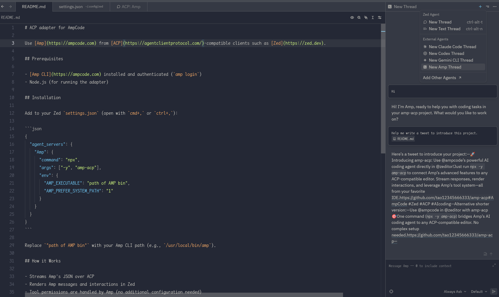
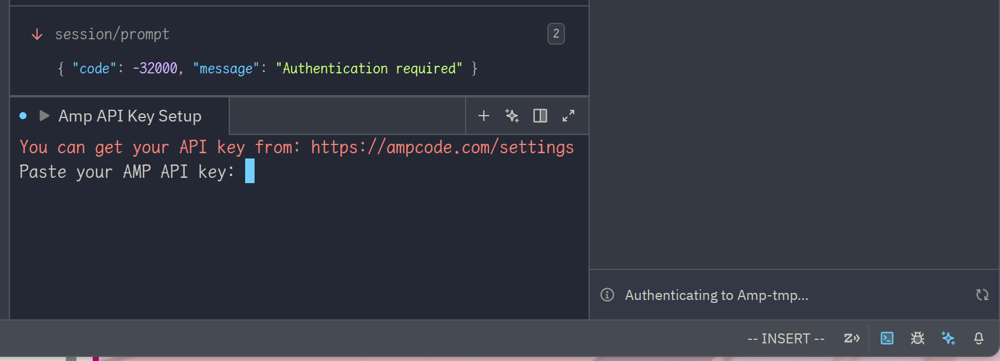

# ACP adapter for Amp

[](https://github.com/tao12345666333/amp-acp/actions/workflows/ci.yml)
[](https://www.npmjs.com/package/amp-acp)



Use [Amp](https://ampcode.com) from [ACP](https://agentclientprotocol.com/)-compatible clients such as [Zed](https://zed.dev) or [Toad](https://github.com/batrachianai/toad).

## Prerequisites

amp-acp uses the Amp CLI as its default execution runtime. Install the [latest Amp CLI](https://ampcode.com/manual#get-started), sign in, and verify it is available before installing the adapter:

```bash
amp login
amp --version
```

If your editor does not inherit your shell `PATH`, set `AMP_CLI_PATH` to the absolute path printed by `command -v amp` (macOS/Linux) or `where amp` (Windows).

## Installation

### Option 1: Zed ACP Registry (Recommended)

Install Amp directly from Zed's ACP Registry:

1. In Zed, open the **Agent Panel**
2. Click **+**, then select **+ Add More Agents**
3. Search for **Amp** and install it

Zed will automatically download the correct binary for your platform.

### Option 2: Pre-built Binary

Download the adapter binary from the [GitHub Releases](https://github.com/tao12345666333/amp-acp/releases) page. The adapter itself has no JavaScript runtime dependency, but the Amp CLI described above is required for agent execution.

| Platform | Architecture | Binary |
|----------|-------------|--------|
| Linux | x64 | `amp-acp-linux-x64` |
| Linux | arm64 | `amp-acp-linux-arm64` |
| macOS | x64 (Intel) | `amp-acp-darwin-x64` |
| macOS | arm64 (Apple Silicon) | `amp-acp-darwin-arm64` |
| Windows | x64 | `amp-acp-windows-x64.exe` |

Download the binary for your platform, make it executable (`chmod +x` on Linux/macOS), and add to your Zed `settings.json` (open with `cmd+,` or `ctrl+,`):

```json
{
  "agent_servers": {
    "Amp": {
      "type": "custom",
      "command": "/path/to/amp-acp-darwin-arm64",
      "env": {
        "AMP_CLI_PATH": "/absolute/path/to/amp"
      }
    }
  }
}
```

### Option 3: npx

```json
{
  "agent_servers": {
    "Amp": {
      "type": "custom",
      "command": "npx",
      "args": ["-y", "amp-acp"],
      "env": {
        "AMP_CLI_PATH": "/absolute/path/to/amp"
      }
    }
  }
}
```

Requires Node.js 18+.

## Authentication

Run `amp login` before starting amp-acp. The adapter and CLI share the same Amp credentials. For headless environments, `AMP_API_KEY` is also supported. `amp-acp --setup` remains available as an interactive API-key setup fallback.

Clients that advertise `clientCapabilities.auth.terminal: true` receive a standard ACP terminal authentication method, which appends `--setup` to their configured agent invocation. Other clients continue to receive the legacy `_meta['terminal-auth']` setup method for compatibility with Zed and other legacy clients.



## Features

- **Streaming responses** — Amp messages, tool calls, and thinking are streamed in real-time via ACP
- **Image support** — Sends attached PNG, JPEG, GIF, and WebP images to Amp in local and Orb sessions, and handles image content blocks from Amp (base64 and URL)
- **MCP passthrough** — MCP servers configured in Zed are automatically passed through to Amp
- **Session configuration** — Choose local or Orb execution, configure permissions (*Default* or *Bypass*), select the current Amp mode, and set reasoning effort via ACP config options. Amp modes include the built-in `low`, `medium`, `high`, and `ultra` modes, plus any agent modes registered by Amp plugins (project, system, personal, or workspace — such as `grok45` from the Workspace `official-modes` plugin)
- **Reasoning stream** — Amp thinking blocks are streamed as ACP `agent_thought_chunk` updates. Set `AMP_ACP_DISABLE_THINKING=1` to request plain `--stream-json` output instead
- **Reasoning effort** — pick `auto`, `none`, `minimal`, `low`, `medium`, `high`, `xhigh`, or `max` through the ACP config options; amp-acp applies it to local CLI turns as the `--features effort:<value>` thread feature
- **Prompt queue** — concurrent prompts for one session are serialized, and `session/cancel` cancels both the active turn and queued prompts
- **`/init` command** — Type `/init` to generate an `AGENTS.md` file for your project
- **Conversation continuity** — Thread context is preserved across multiple prompts within a session
- **Session resume** — `session/load` reattaches to the underlying Amp thread after amp-acp restarts, so ACP clients can reopen earlier sessions
- **Session metadata** — each session publishes a title derived from the first prompt (60 characters, whitespace collapsed) and an `updatedAt` timestamp after every turn via `session_info_update`; both are persisted with the session mapping and restored on load or resume
- **Native thread lifecycle** — ACP clients can persist Amp's durable thread ID and archive or unarchive that exact thread
- **Token usage** — each `session/prompt` answers with the turn's token usage (`PromptResponse.usage`: input, output, cache reads and writes), counted from the usage Amp reports for each model response
- **Context usage and notices** — stream `usage_update` from the latest model call and map Amp stop reasons (`max_tokens`, `max_turn_requests`); report failed MCP servers and permission denials as ACP notices when the client supports them

### Context usage and session notices

While a turn runs, amp-acp sends an ACP `usage_update` whenever the latest model call reports different context usage. `used` is that response's input, cache-read, cache-write, and output tokens; `size` comes from `AMP_ACP_CONTEXT_WINDOW_SIZE` and defaults to a conservative `200000`. Set the variable to the context window of the model you use if your client should display a more precise percentage. The final token totals remain available on `PromptResponse.usage`.

Amp stop reasons are mapped to ACP: `max_tokens` becomes `max_tokens`, `error_max_turns` becomes `max_turn_requests`, and cancellation remains `cancelled`. Other execution errors keep their error message instead of being reported as a refusal.

When the client advertises `clientCapabilities.session.notices`, failed, denied, or registry-blocked MCP servers and Amp permission denials are sent as live `notice` updates. Clients without that capability receive the same information as an ordinary agent message so it stays visible in the transcript.

### Image prompts

ACP image blocks must contain base64 `data` and a supported `mimeType` (`image/png`, `image/jpeg`, `image/gif`, or `image/webp`). Unsupported types, empty data, and malformed base64 return an invalid-params error rather than running an incomplete prompt.

Local image turns use Amp CLI's `--stream-json-input` with ordered text/image content blocks. Orb image turns use `--orb-execute --attach`: images are written to private temporary files, uploaded by Amp, and appended to the text prompt as Amp attachment URLs in image order. Temporary files are removed after execution, including failure and cancellation. Images are uploaded to Amp, not left as local paths the orb cannot read.

Image turns use these CLI routes even with `AMP_ACP_TRANSPORT=sdk`: the pinned SDK's streaming input schema accepts text only, and its Orb executor rejects streaming input. Text-only turns retain their existing transport. Use an Amp CLI supporting `--stream-json-input` and, for Orb images, `--attach` (verified with CLI `0.0.1793433646-gfaad62`). If the installed CLI lacks those flags or an upload fails, the prompt fails visibly; images are never silently omitted. See [Amp CLI](https://ampcode.com/docs/cli) and [SDK input types and remote executor restrictions](https://ampcode.com/docs/sdk/typescript).

### Native Amp thread lifecycle extension

Amp's streamed `session_id` is a durable `T-...` thread ID, distinct from amp-acp's `S-...` ACP session ID. amp-acp persists that exact mapping under `$XDG_STATE_HOME/amp-acp/sessions` (or `$AMP_ACP_STATE_DIR/sessions`) so `session/resume`, `session/load`, and native archival remain safe after adapter restarts. It never reconstructs the relationship from a working directory, title, timestamp, or thread listing.

Mappings are small JSON records written atomically to an owner-only state directory (`0700`) with owner-only files (`0600`). They contain the ACP session ID, Amp thread ID, and the session's permission mode, Amp mode, reasoning effort, and working directory — never prompts, responses, or credentials.

Compatible ACP clients can detect protocol revision 1 at `agentCapabilities._meta["amp-acp/thread-lifecycle"]` and use these custom methods:

- `amp-acp/session/native-metadata` with `{ "sessionId": "S-..." }` returns `{ "version": 1, "sessionId": "S-...", "ampThreadId": "T-..." | null }`.
- `amp-acp/thread/set-archived` with `{ "sessionId": "S-...", "threadId": "T-...", "archived": true | false }` validates both IDs against the persisted mapping, then invokes `amp threads archive <thread-id>` or `amp threads archive --unarchive <thread-id>` directly without a shell.

Archival is separate from ACP session close. Missing or mismatched mappings fail safely instead of selecting another Amp thread.

Existing ACP clients remain compatible and can ignore the extension metadata. Sessions created before 0.10.0 have no durable mapping, so they cannot be resumed or archived through this extension; starting a new session and completing its first prompt creates the mapping. Inferring a mapping from Amp's latest thread is deliberately forbidden because another CLI, editor, or concurrent session may have created a newer thread. The separate `AMP_ACP_CONTINUE_LATEST=1` option below remains an explicit request to continue the latest thread for a new session, not a lifecycle recovery mechanism.

### Orb execution

Select **Orb** under **Execution Environment** in the ACP session configuration to run the Amp thread in a remote Amp Orb. Text-only Orb sessions use the `@ampcode/sdk` transport, even when local execution uses the default CLI transport. Orb image turns use the CLI `--orb-execute --attach` route described under [Image prompts](#image-prompts).

By default, Amp infers the project from the Git remotes of the directory supplied by the ACP client. Set `AMP_ACP_ORB_PROJECT` to an Amp project reference (`namespace/name`, `owner/repo`, or a repository URL) to override that inference.

Permissions, MCP servers, skills, and enabled tools supplied by the local client do not apply inside an Orb. Configure them on the Amp project instead. Authentication must have access to Amp Orbs and to the selected project.

A gated live end-to-end test exercises this path against a real Amp account: `AMP_ACP_ORB_LIVE_E2E=1 bun run test:e2e:orb`. It creates a session in this repository, switches the execution environment to Orb, and runs one `low`-mode turn. It consumes Amp credits and requires orb access to the project inferred from the git remote.

### Continuing the latest thread on session start

When the environment variable `AMP_ACP_CONTINUE_LATEST=1` is set, the first prompt in a fresh ACP session will continue the most recent Amp thread on this installation (equivalent to `amp threads continue`) instead of starting a new one. Useful when the ACP session follows on from prior `amp` CLI activity (for example, a one-shot `amp -x` invocation) and you want the chat to inherit that context. Off by default.

### Resuming sessions

amp-acp advertises the ACP `loadSession` capability. Once a prompt has started an Amp thread, the ACP session ID is mapped to that thread in the durable session store described above (`$XDG_STATE_HOME/amp-acp/sessions`, one file per session; respects `%LOCALAPPDATA%\amp-acp` on Windows and can be overridden with `AMP_ACP_STATE_DIR`). The store also records the session's permission mode, Amp mode, and execution environment, so when a client calls `session/load`, amp-acp restores those settings and continues the same thread (equivalent to `amp threads continue <id>`), even across amp-acp process restarts.

During `session/load`, prior messages are replayed to the client as `session/update` notifications (user/agent messages, thinking, and tool calls) using `amp threads export`, so the client can rebuild the transcript. Replay is best-effort: if the export fails, the session still loads and the thread still continues with full server-side context.

### Session title and timestamp

amp-acp sends the standard `session_info_update` notification with a human-readable `title` and an ISO 8601 `updatedAt` timestamp. The title comes from the first user prompt: whitespace is collapsed, the text is truncated to 60 characters, and a first turn with no text falls back to `Amp session`. amp-acp never calls a model to summarize the session.

Both values are stored alongside the ACP-to-Amp mapping and restored by `session/load` and `session/resume`. During `session/load`, a title or timestamp exported by `amp threads export` takes precedence, so a title renamed in Amp remains authoritative.

### Amp execution transport

By default, amp-acp executes the installed Amp CLI directly through its streaming JSON interface. Set `AMP_ACP_TRANSPORT=sdk` to use `@ampcode/sdk` as a compatibility fallback; both transports support the current `low`, `medium`, `high`, and `ultra` Amp modes, plus any plugin agent modes (see below).

### Plugin agent modes

Amp plugins can register custom agent modes with `amp.registerAgentMode(...)` plus a matching `// @amp-agent-mode {"key":"...","label":"..."}` metadata comment in the plugin source (see [Amp's plugin docs](https://ampcode.com/manual#plugins)). Examples include `grok45` from `@amp/grok-45-mode` or any mode listed on the [Modes page](https://ampcode.com/modes) under *Agent Mode Plugins*.

amp-acp auto-discovers these modes and appends them to the Amp Mode selector in your ACP client. For example, with the Workspace `official-modes` plugin loaded you get:

```text
Amp Mode  [Medium ▾]
  Low
  Medium
  High
  Ultra
  Grok 4.5
```

Discovery uses two sources, in Amp's plugin precedence order (project, then system, then personal/workspace):

- `// @amp-agent-mode` comments in project plugins (`.amp/plugins` under the session cwd) and system plugins (`~/.config/amp/plugins` on macOS/Linux, `%USERPROFILE%\.config\amp\plugins` on Windows). These supply both the mode key and its label.
- `amp plugins list`, which reports every plugin Amp actually loaded — including Personal and Workspace plugins that are not on the local filesystem. Mode keys from that listing that were not already found locally are appended (the CLI does not print labels, so the key is used as the display name).

Set `AMP_ACP_SYSTEM_PLUGIN_DIR` to point at a different system plugin directory. Set `AMP_ACP_DISABLE_PLUGIN_LIST=1` to skip the CLI listing (tests use this). Plugin modes are passed through as-is to the Amp CLI (`--mode <key>`) or the Amp SDK; Amp rejects keys that do not match a loaded plugin.

The `amp plugins list` result is cached for 60 seconds per working directory, so a mode plugin installed while amp-acp is running appears in the selector of new sessions within about a minute, without an adapter restart.

The selector lists the discovered modes, but the adapter accepts any non-empty mode value and passes it through to Amp unchanged. Amp is the authority on mode resolution: it matches mode keys case-insensitively and rejects unknown modes when the prompt runs. This keeps amp-acp forward-compatible as Amp adds modes — including a mode plugin installed moments ago, before discovery picks it up. Likewise, a session restored via `session/load` or `session/resume` keeps its persisted mode even when the mode's plugin is temporarily unloaded; the value stays visible and selected in the option list.

### Reasoning effort

The ACP config option **Reasoning Effort** selects how much reasoning Amp performs for the current mode. It is independent of the Amp mode: mode chooses the model/routing tier, effort chooses the reasoning depth.

Supported values are `auto` (omit the feature and use Amp's default), `none`, `minimal`, `low`, `medium`, `high`, `xhigh`, and `max`. amp-acp passes the value as the `--features effort:<value>` thread feature to the CLI transport. The Amp SDK transport used for Orb execution has no equivalent option, so Orb sessions follow the mode's routing; tune effort for Orb threads with the Amp project's mode settings. The selection is persisted with the session mapping and restored by `session/load` and `session/resume`.

Amp thinking blocks are included in the stream by default (`--stream-json-thinking` or SDK `thinking: true`) and forwarded as ACP `agent_thought_chunk` updates. Set `AMP_ACP_DISABLE_THINKING=1` to use plain `--stream-json` output.

### Prompt queue and cancellation

ACP v1 describes `session/prompt` as a long-running request, so most clients wait for the response before sending the next prompt. Some clients can send a follow-up while a turn is still running. amp-acp serializes prompts per session:

- The first prompt starts immediately.
- Up to 32 follow-up prompts are queued in arrival order.
- When the active turn finishes, the next queued prompt starts and continues the same Amp thread.
- `session/cancel` aborts the active turn and resolves every queued prompt with `stopReason: "cancelled"` without starting them.
- A prompt sent after cancellation starts a new turn.
- A 33rd pending prompt is rejected with an invalid-params error instead of growing memory without bound.

The queue is internal to amp-acp and requires no new ACP capability. ACP v2 has native prompt queueing and steering; this is the v1 compatibility path.

## MCP Configuration Passthrough

MCP servers configured in Zed's `context_servers` are automatically forwarded to Amp. This is compatible with how other ACP agents like [Claude Code](https://github.com/zed-industries/claude-code-acp) and [Codex](https://github.com/zed-industries/codex-acp) handle MCP servers.

### Supported MCP Server Types

| Type | Description | Example |
|------|-------------|---------|
| **stdio** | Local command-line MCP servers | `@playwright/mcp`, `@modelcontextprotocol/server-filesystem` |
| **HTTP** | Remote HTTP MCP servers | `https://mcp.exa.ai/mcp` |
| **SSE** | Remote Server-Sent Events MCP servers | `https://mcp.monday.com/sse` |

### Example: Using Exa Search with Amp

```json
{
  "agent_servers": {
    "Amp": {
      "type": "custom",
      "command": "npx",
      "args": ["-y", "amp-acp"]
    }
  },
  "context_servers": {
    "exa": {
      "url": "https://mcp.exa.ai/mcp"
    }
  }
}
```

### Example: Multiple MCP Servers

```json
{
  "agent_servers": {
    "Amp": {
      "type": "custom",
      "command": "npx",
      "args": ["-y", "amp-acp"]
    }
  },
  "context_servers": {
    "playwright": {
      "command": "npx",
      "args": ["-y", "@playwright/mcp@latest", "--headless"]
    },
    "filesystem": {
      "command": "npx",
      "args": ["-y", "@modelcontextprotocol/server-filesystem", "/path/to/allowed"]
    },
    "github": {
      "command": "npx",
      "args": ["-y", "@modelcontextprotocol/server-github"],
      "env": {
        "GITHUB_PERSONAL_ACCESS_TOKEN": "your-token"
      }
    }
  }
}
```

For more details, see [docs/mcp-passthrough.md](docs/mcp-passthrough.md).

## Development

```bash
bun install
bun run build        # Bundle to dist/index.js
bun run lint         # Type-check with tsc
bun test src/        # Run unit tests
bun run test:binary  # Run binary integration and ACP client E2E tests
bun run test:all     # Run all tests
```

The regular suite uses a deterministic fake CLI and is safe for CI. Maintainers can additionally run the full-stack verification with one command against their installed, authenticated Amp CLI:

```bash
bun run test:e2e:live
```

This opt-in command is never enabled by CI. It runs the binary integration and fake-CLI e2e suite plus two live layers: the real Amp CLI layer creates a temporary workspace, runs two short prompts in `low` mode, and verifies streaming and same-thread continuation through the official ACP client SDK, then registers a plugin-defined custom agent mode (`acp-flash`, pinned to `zhipuai/glm-5.3-flash`), selects it through the ACP config options, prompts with it, and confirms via `amp threads usage --details` that the custom model served the request; the orb layer runs a turn in a remote Amp orb through the `execution-environment` config option. All of it consumes a small amount of Amp usage: the custom-mode test requires the pinned model to be usable by your Amp account, and the orb test requires orb access to the repository's Amp project (inferred from the git `origin` remote).

Everything also runs inside an Amp orb out of the box — orbs ship the Amp CLI and authentication, and the repository's `.agents/setup` installs the dependencies — so maintainers can ask an Amp thread to run `bun run test:e2e:live` instead of testing with a local editor.

## Troubleshooting

**Adapter doesn't start**: Make sure you have Node.js 18+ (for `npx`) or use a pre-built binary / Zed extension instead.

**Connection issues**: Restart Zed and try again. The adapter creates a fresh connection each time.

**Amp CLI not found**: Run `amp --version` in a terminal. If it works there but not in your editor, set `AMP_CLI_PATH` to the absolute CLI path in the agent server environment.

**Tool execution problems**: Check Zed's output panel for detailed errors from the Amp CLI.

**MCP server not connecting**: Ensure the MCP server command is correct and any required environment variables are set. Check Zed's logs for connection errors.

## License

[Apache-2.0](https://opensource.org/licenses/Apache-2.0)
